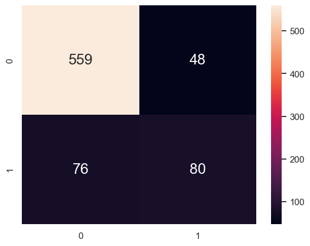
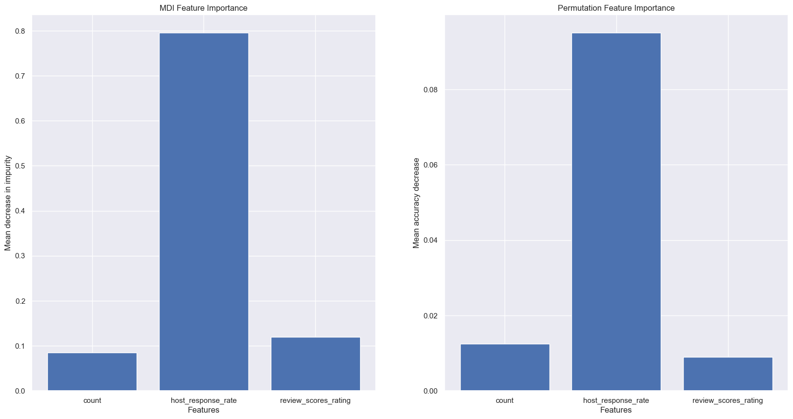
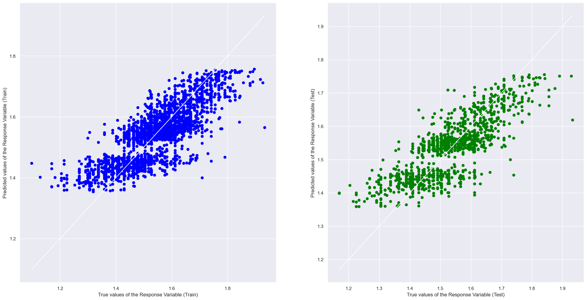

# Airbnb Mini Project

This mini project analyses the Seattle Airbnb Open Data using exploratory data analysis and supervised machine learning. It contains two related modelling tasks:

1. **Classification:** predict whether an Airbnb host is a superhost.
2. **Regression:** predict the nightly price of an Airbnb listing.

## Dataset

The notebooks use the following files from the `archive` folder:

- `listings.csv`: listing, host, location, room, pricing, availability, and review information.
- `calendar.csv`: daily listing availability and price information. It is used in the classification workflow to derive booking-related information.

The main listing dataset contains 3,818 listings and 92 variables in the original project workflow.

## Classification

Notebook: [`MINI PROJECT (CLASSIFICATION).ipynb`](MINI%20PROJECT%20%28CLASSIFICATION%29.ipynb)

### Objective

Predict the binary `host_is_superhost` outcome and investigate which host, listing, review, and booking-related criteria are most associated with superhost status.

Although Airbnb’s superhost requirements are publicly available, this analysis examines how strongly different host and listing characteristics are associated with superhost status in the Seattle dataset. The results can help hosts prioritise improvements and assess whether the published criteria are reflected in real-world listing data.

### Main workflow

- Load and inspect listing and calendar data.
- Count unavailable calendar dates as a proxy for bookings.
- Clean missing values and convert price and percentage fields to numeric values.
- Select relevant numerical and categorical predictors.
- Address class imbalance using techniques such as SMOTE
- Split the data into training and test sets.
- Train a `RandomForestClassifier`.
- Tune hyperparameters using  grid search approaches.
- Evaluate performance using accuracy, precision, recall, F1 score, confusion matrices, and cross-validation.
- Use permutation importance and tree visualisation to interpret important predictors.

## Regression

Notebook: [`MINI PROJECT (REGRESSION).ipynb`](MINI%20PROJECT%20%28REGRESSION%29.ipynb)

### Objective

Predict the nightly price of an Airbnb listing from listing characteristics and host or review information.

This analysis can help new hosts set a fair and competitive price for their property. Guests can also use the predicted price as a reference point when deciding whether a listing represents good value.

### Main workflow

- Load and inspect `listings.csv`.
- Remove currency symbols and percentage signs from relevant columns.
- Convert price and host response rate to numeric values.
- Keep numerical variables and selected categorical variables.
- Remove identifiers, geographic coordinates, unusable columns, and highly incomplete fields such as `square_feet`.
- Fill remaining numerical missing values with medians.
- Apply a natural-log transformation to the target price to reduce skew.
- Explore distributions, correlations, boxplots, violin plots, histograms, and pairwise relationships.
- One-hot encode selected categorical variables such as room type and bed type.
- Split the data into training and test sets.
- Train and evaluate a `RandomForestRegressor` using explained variance, R-squared, and mean squared error.
- Use five-fold cross-validation and `GridSearchCV` for hyperparameter tuning.
- Compare Random Forest, Gradient Boosting, and AdaBoost regressors.
- Convert log-scale predictions back to the original price scale for interpretation.

## Selected Results

### Classification

Test-set confusion matrix:



Feature-importance analysis:



### Regression

Actual versus predicted values for the regression models:



## Requirements

The notebooks use Python with the following main packages:

```text
pandas
numpy
matplotlib
seaborn
scikit-learn
scipy
imbalanced-learn
```

Install the dependencies with:

```bash
python -m pip install pandas numpy matplotlib seaborn scikit-learn scipy imbalanced-learn
```

## Running the notebooks

1. Open the `Mini Project` folder in VS Code or Jupyter.
2. Ensure the data files are available in the expected `archive` folder.
3. Select a Python environment containing the dependencies above.
4. Run the cells in either notebook from top to bottom.

Some original notebook cells contain machine-specific Windows paths. Update those paths to match the location of the local `archive` folder before running the notebooks.

## Limitations

- The analysis is based on a historical Seattle Airbnb snapshot and may not represent current listings or pricing.
- Median imputation and feature selection were performed directly in the notebooks rather than through reusable preprocessing pipelines.
- The regression target is log-transformed, so metrics calculated before inverse transformation are on the log-price scale.
- `review_scores_rating` was not identified by the model as an important determining factor of superhost status. One possible explanation is that review scores are concentrated at a high level, with a median of 96 across listings, leaving relatively little variation for the model to use to distinguish superhosts from other hosts. This does not mean review quality is unimportant; it means its predictive contribution is limited in this dataset and model.
- Results depend on the selected features, split seed, class-balancing approach, and hyperparameters.
